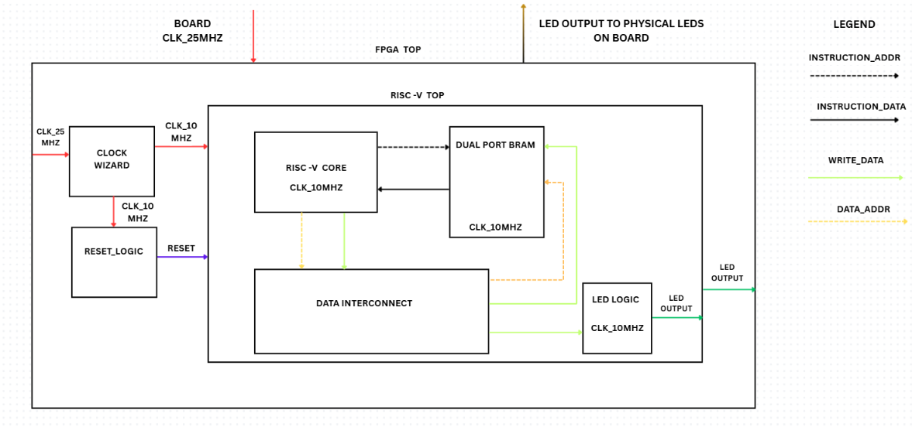
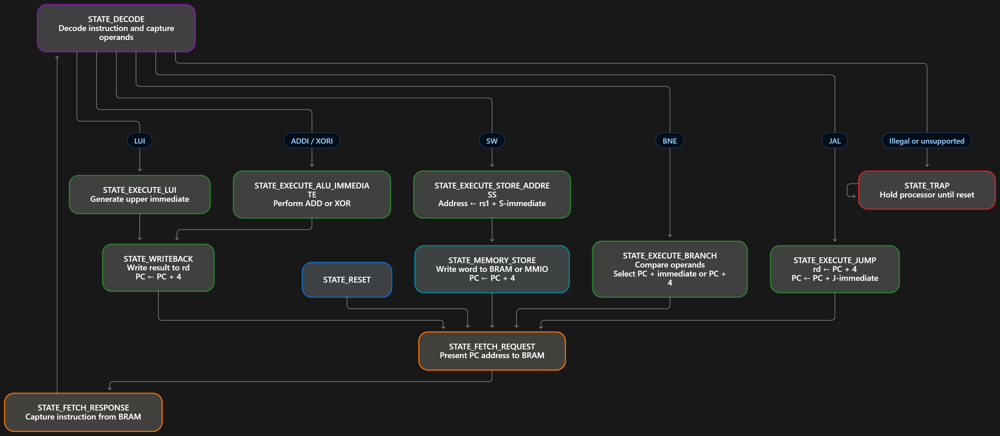

# Multicycle RV32I-Subset SoC on AMD Kria KR260

A 32-bit, non-pipelined, multicycle RISC-V processor and minimal system-on-chip
implemented in VHDL. The design runs from on-chip block RAM, drives two
memory-mapped LEDs, and has been synthesized, implemented, and validated in
hardware on the AMD Kria KR260 Robotics Starter Kit.

> **Project status:** hardware validated. The firmware alternates the KR260 UF1
> and UF2 user LEDs using instructions executed by the custom processor.

This is an educational **RV32I subset**, not a complete RV32I-compliant core.
The currently implemented instructions are `LUI`, `ADDI`, `XORI`, `SW`, `BNE`,
and `JAL`.

## Hardware demonstration

The processor fetches a small program from BRAM, writes patterns `01` and `10`
to a memory-mapped LED register, and uses a software loop to create a visible
delay. At the 10 MHz processor clock, each pattern remains visible for about
0.94 seconds.

## Architecture



The top level accepts the KR260 carrier card's 25 MHz PL clock. A Clocking
Wizard generates the 10 MHz processor clock, and reset logic holds the SoC in
reset until the MMCM has locked. The SoC contains:

- a custom multicycle RV32I-subset processor;
- a 4 KiB unified instruction/data BRAM;
- a data-side address interconnect; and
- a two-bit, memory-mapped LED peripheral.

The core uses BRAM Port A for synchronous instruction fetches. Data writes from
the core pass through the interconnect, which selects either BRAM Port B or the
LED peripheral according to the address.

### Multicycle control flow



Every instruction passes through the fetch and decode states before taking an
instruction-specific execution path. Unsupported or illegal instructions enter
`STATE_TRAP`, where architectural state remains unchanged until reset.

## Supported instructions

| Instruction | Format | Operation |
|---|---|---|
| `LUI` | U | Load a 20-bit immediate into the upper bits of `rd` |
| `ADDI` | I | Add a sign-extended immediate to `rs1` |
| `XORI` | I | XOR `rs1` with a sign-extended immediate |
| `SW` | S | Store a 32-bit word to BRAM or memory-mapped I/O |
| `BNE` | B | Branch when `rs1` and `rs2` are not equal |
| `JAL` | J | PC-relative jump and link |

The integer register file contains 32 registers of 32 bits each. Register `x0`
is hardwired to zero.

## Memory map

| Address range | Size | Function |
|---|---:|---|
| `0x0000_0000` - `0x0000_0FFF` | 4 KiB | Unified instruction/data BRAM |
| `0x4000_0000` | 32 bits | LED MMIO register; bit 0 drives UF1 and bit 1 drives UF2 |

The core produces byte addresses. Because the BRAM is organized as 1024 32-bit
words, address bits `[11:2]` select the BRAM word and bits `[1:0]` represent the
byte position within that word.

## Firmware

The BRAM is initialized from [`firmware/led_blink.coe`](firmware/led_blink.coe).
It contains the following program:

```asm
        lui   x5, 0x40000       # x5 = LED MMIO address 0x4000_0000
        addi  x6, x0, 1         # pattern 01: UF1 on, UF2 off

loop:
        sw    x6, 0(x5)         # write pattern to the LED register
        lui   x7, 0x00100       # x7 = 0x0010_0000 delay count

delay:
        addi  x7, x7, -1
        bne   x7, x0, delay
        xori  x6, x6, 3         # alternate 01 and 10
        jal   x0, loop
```

The `ADDI` and `BNE` instructions require approximately nine processor cycles
per delay-loop iteration. With a 10 MHz clock and `0x0010_0000` iterations, the
delay is approximately:

```text
1,048,576 iterations x 9 cycles x 100 ns = 0.944 seconds
```

## RTL organization

```text
rtl/
|-- package/
|   `-- rv32i_pkg.vhd
|-- core/
|   |-- rv32i_alu.vhd
|   |-- rv32i_control_fsm.vhd
|   |-- rv32i_core.vhd
|   |-- rv32i_decoder.vhd
|   |-- rv32i_immediate_generator.vhd
|   `-- rv32i_register_file.vhd
|-- soc/
|   |-- led_mmio.vhd
|   |-- rv32i_fpga_top.vhd
|   |-- rv32i_soc.vhd
|   |-- soc_data_interconnect.vhd
|   `-- unified_bram.vhd
|-- tb/
|   `-- self-checking VHDL testbenches
`-- xdc/
    `-- riscv.xdc
```

### Main modules

| Module | Purpose |
|---|---|
| `rv32i_fpga_top` | KR260 clock, reset, SoC, and physical LED integration |
| `rv32i_soc` | Integrates the processor, BRAM, interconnect, and LED MMIO |
| `rv32i_core` | Multicycle datapath and control integration |
| `rv32i_control_fsm` | Moore-style multicycle instruction controller |
| `rv32i_decoder` | Opcode and `funct3` instruction decoding |
| `rv32i_immediate_generator` | I/S/B/U/J immediate extraction and sign extension |
| `rv32i_register_file` | Two-read-port, one-write-port integer register file |
| `rv32i_alu` | Addition, XOR, and immediate pass-through operations |
| `unified_bram` | Wrapper around the Xilinx true dual-port Block Memory Generator |
| `soc_data_interconnect` | BRAM and LED address decoding and write routing |
| `led_mmio` | Synchronous two-bit memory-mapped output register |

## Verification

The project includes self-checking VHDL testbenches for individual modules and
for integrated firmware execution.

| Testbench | Scope |
|---|---|
| `tb_rv32i_alu` | ALU operations |
| `tb_rv32i_register_file` | register reads, writes, and hardwired `x0` |
| `tb_rv32i_immediate_generator` | I/S/B/U/J immediate formats |
| `tb_rv32i_decoder` | supported and illegal instruction decoding |
| `tb_rv32i_control_fsm` | state transitions and control outputs |
| `tb_rv32i_core` | complete processor instruction execution |
| `tb_unified_bram` | initialized instruction reads and byte-enabled data writes |
| `tb_soc_data_interconnect` | BRAM, LED, invalid, and misaligned address routing |
| `tb_led_mmio` | LED writes, retention, and reset behavior |
| `tb_rv32i_soc` | BRAM firmware execution through the complete SoC |

The complete SoC test confirms that the firmware performs the first LED MMIO
write, enters the `BNE` delay loop, and does not enter the trap state. It does
not simulate all one million delay iterations; the full delay is demonstrated
on hardware.

## FPGA target and tools

| Item | Configuration |
|---|---|
| Board | AMD Kria KR260 Robotics Starter Kit |
| Device | `xck26-sfvc784-2LV-c` |
| Tool | AMD Vivado 2024.2 |
| RTL language | VHDL-2008 |
| External clock | 25 MHz on package pin `C3` |
| Processor clock | 10 MHz generated by `clk_wiz_0` |
| Program memory | 1024 x 32-bit true dual-port BRAM |
| Top-level entity | `rv32i_fpga_top` |

### KR260 pin assignments

| Top-level port | Package pin | I/O standard | Function |
|---|---|---|---|
| `board_clk_25mhz` | `C3` | LVCMOS18 | 25 MHz carrier-card clock |
| `uf1_led` | `F8` | LVCMOS18 | UF1 user LED, active high |
| `uf2_led` | `E8` | LVCMOS18 | UF2 user LED, active high |

The complete constraints are in [`rtl/xdc/riscv.xdc`](rtl/xdc/riscv.xdc).

## Implementation results

The following values are taken from the placed utilization report and routed
timing summary generated by Vivado 2024.2:

| Resource/metric | Result |
|---|---:|
| CLB LUTs | 425 |
| CLB registers | 188 |
| Block RAM tiles | 1 |
| DSP slices | 0 |
| MMCMs | 1 |
| BUFGCEs | 2 |
| Processor clock | 10 MHz |
| Setup WNS | 95.738 ns |
| Hold WHS | 0.048 ns |
| Failing timing endpoints | 0 |

All user-specified timing constraints are met.

## Building the project

### Prerequisites

- AMD Vivado 2024.2 with Kria K26/KR260 device support;
- a KR260 board and a supported JTAG connection for hardware programming; and
- Git, if cloning the repository.

### Open the Vivado project

Clone the repository and open the included project:

```powershell
git clone https://github.com/bharadwajakshay4-dotcom/-RV32I-implementation-FPGA.git
Set-Location '.\-RV32I-implementation-FPGA'
```

Open `project_1.xpr` in Vivado. If requested, generate output products for:

- `blk_ram` - 1024 x 32-bit true dual-port BRAM initialized by the COE file;
- `clk_wiz_0` - 25 MHz input to 10 MHz output; and
- any optional debug IP included in the Vivado project.

### Run the SoC simulation

In Vivado:

1. Set `tb_rv32i_soc` as the simulation top.
2. Select **Run Simulation -> Run Behavioral Simulation**.
3. In the XSim Tcl console, run:

```tcl
run all
```

The expected final message is:

```text
All RV32I SoC tests passed
```

The simulation stops automatically after the self-checking assertions complete.

### Generate the bitstream

1. Set `rv32i_fpga_top` as the design top.
2. Generate all required IP output products.
3. Run synthesis.
4. Run implementation and confirm that timing constraints are met.
5. Generate the bitstream.
6. Open Hardware Manager, connect to the KR260, and program the device.

After configuration, UF1 and UF2 should alternate approximately every 0.94
seconds.

## Current limitations

- Only the six instructions listed above are implemented.
- Load instructions and the data-memory readback path are not implemented.
- Only full-word stores are supported.
- There are no interrupts, CSRs, privilege modes, caches, or external bus.
- Illegal instructions enter a persistent trap state until reset.
- The design has not been run against the official RISC-V architectural test
  suite and must not be described as a fully compliant RV32I processor.

## Roadmap

- Add `LW` and complete the BRAM-to-register writeback path.
- Add RV32I register-register ALU operations and remaining branch instructions.
- Add `JALR`, byte/halfword loads, and byte/halfword stores.
- Add a memory-mapped UART peripheral.
- Add automated firmware generation and regression scripts.
- Run RISC-V architectural compliance tests after completing the base ISA.

